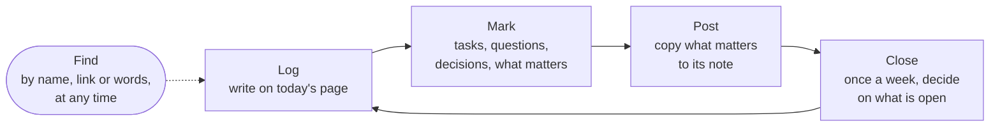
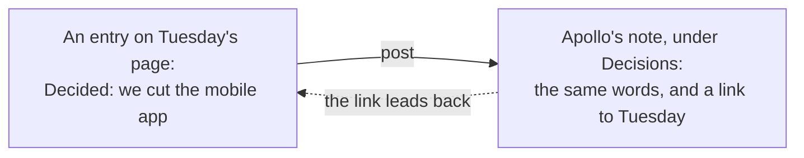
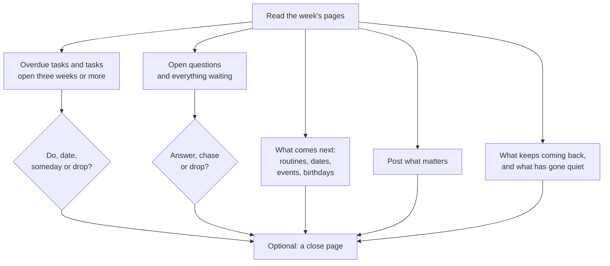
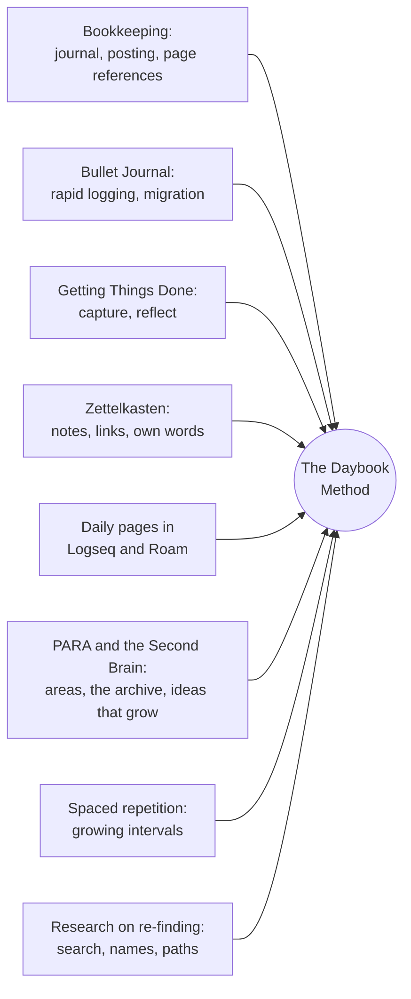

# The Daybook Method

*Write it in the daybook. Post what matters. Close the week.*

The Daybook Method is one way of keeping notes for all of your life: work, home and family. You write everything in one place as it happens: today's page. Later, and only for what matters, you post an entry to the note it is about. You find things by their name, their links or their words. Once a week, or on a cycle you choose, you close what is open.

> **Stop deciding where a thought belongs before you write it down. Write it in the daybook, post what matters, and close the week.**

It asks for no decision about where things go while you write, keeps your words as you wrote them, and survives the weeks you skip. It is plain text files in folders, and it is built to work by hand: a text editor is enough, and even a paper notebook can follow it. The pkm tool speeds up the mechanical parts, and an AI agent can read your week and draft the posting and the close for you to approve ([the agentic layer](https://github.com/Zejnilovic/agentic-pkms/blob/main/docs/methodology.md)).

Every example comes from two [made-up example vaults](examples/README.md), kept through the same week of November 2026. The **work** vault is about a project called Apollo, a customer called Acme, and two colleagues, Jane Doe and John Roe. The **family** vault is shared by two parents, Alex and Sam, and is about a bathroom, a summer trip, a school form and the bills.

The name is a nod to bookkeeping, where every transaction was written down as it happened, and only later posted to the account it belonged to.

## The method on one page



You **log** on today's page and **mark** what needs something as you write. Later you **post** the entries that matter into the notes they are about. Once a week, or once a cycle of your own, you **close**: you decide on everything still open. At any time you **find** things by name, by link or by words, never by remembering where you put them.

Eight words carry the method:

| Term | Meaning |
|---|---|
| **daybook** | Your pages, one per day. Every entry goes on today's page first. |
| **entry** | One line you write on a page, usually with the time: `- 14:20 John says the budget needs sign-off` |
| **mark** | A sign on an entry that says what it is: a task, an event, a question, a decision, something important, an idea, something no longer true, a question to recall |
| **note** | A page about one thing: a person, a project, an area you look after, a topic, a course |
| **link** | A note's name in double brackets, `[[apollo]]`. The link is the relationship. |
| **post** | To copy an entry, word for word, into the note it is about, with a link to its day |
| **close** | The decision on what is open, once a week or on the cycle you choose: a task is done, dated, made someday or dropped; a question or a wait is answered, chased or dropped |
| **recall** | A question you wrote, with the next day to ask yourself again |

All of it lives in a **vault**: a folder of plain text files. You can keep several, such as one for work and one shared with your family, and each works the same way. A posted entry is still the same words. Where this document says "line", it means a line in a note or in a tool's output.

## Why: four problems with keeping notes

Most systems for personal notes fail in one of three places, and anyone learning something meets a fourth.

**Writing stops when it needs a decision.** A thought arrives during a call. Before it can be written down, the system asks where it goes: which folder, which notebook, which project, which tag. The question is small, but it comes when it is least welcome, and it comes every time. Many people stop writing things down not because writing is hard, but because sorting is.

**What is written cannot be found.** Folders reflect how you thought about something on the day you sorted it. A year later the folder makes sense to nobody, including you. Search helps, but people still like to browse their way to something rather than search for it.[^bergman2008]

**What is open slips.** Tasks, questions and promises get written down and then stay where they were written. Making a specific plan for an unfinished goal can quiet the thoughts it causes,[^masicampo2011] but changing what people intend changes what they do by much less.[^webb2006] A list that only grows stops being trusted, and an untrusted list is not read.

**What you learn fades**, and rereading your notes does little to stop it.[^dunlosky2013]

The Daybook Method answers each with one move. Writing never needs a decision about where things go, because everything goes on today's page. Finding works by name and link, which are both a search and a path to browse. Open items get a decision on a regular rhythm. And learning uses questions asked again after a gap, not rereading.

## Four principles

Every part of the method follows from four principles.

**One method for all of your life.** Work has sprints and boards, home has bills and repairs, and a family has school forms and holidays. Each tends to get its own app, its own list and its own habit, which is one more place to check and one more set of rules to remember. The Daybook Method is the same practice for all of them: a release, a renovation and a busy week with children use the same pages, marks and close. What changes is the vault, not the method.

**By hand first.** Everything in the method can be done with a text editor and a folder. Tools make it faster and an agent makes it cheaper to keep up, but none of them is needed, and none does anything you couldn't do yourself. That is also what keeps an agent cheap: it works with the same files and marks you do.

**Plain text, as a base to build on.** Pages and notes are Markdown files, readable in any editor, on any device, for as long as text files are. No part of the method lives only inside an app, so nothing is hidden, and finding something is never harder than searching a folder. Apps, editor plugins and scripts can all build on the same files; the [reference](#reference) at the end is the whole format they need.

**Designed for digital, still works on paper.** The method uses what files are good at: search, links and exact copies. But each part has a paper form, and the method still works in a notebook, only with slower finding.

## The system

### The daybook

The daybook is your pages, one per day, named after the date and kept in a folder per month: `daybook/2026/11/2026-11-10.md`. A month's folder holds at most 31 pages and reads like a calendar. A page is linked like any note, by its date: `[[2026-11-10]]`. Today's page is the only place you need. You don't open it to decide anything; you open it to write.

A page has two sections. **Log** is where you write, as things happen. **Tasks** is for tasks you want at the top of the page, such as the ones you add from the terminal; a task can just as well sit in the Log, where it came up.

```markdown
# 2026-11-10

## Tasks

## Log

### 10:00 Call with [[acme]] about [[apollo]]

- ! They may cancel the contract if the demo slips again
- Decided: we cut the mobile app from the first release
- Their new contact is Marta Kovac
- I'll send them the revised timeline by Thursday
```

A page is a record. Once the day is over, you change it in only three ways: you tick a task, fix a link, or strike through what is no longer true. If something on it was wrong, you write the correction on today's page. That is what lets a page serve as the source for everything posted from it.

In a vault several people share, such as a family's, each person keeps their own pages, with their name after the date: `daybook/2026/11/2026-11-10-sam.md`, linked as `[[2026-11-10-sam]]`. Nobody writes on someone else's page, so two phones syncing the same folder never change the same file, and every entry says who wrote it.

### Entries

An entry is one line, usually starting with the time. Short entries are easier to post, find and close, so write the way you would speak a note to yourself: "John says the budget needs sign-off", not a paragraph about the budget. At home it is no different: `- 07:50 [[school]]: museum trip on 2026-11-26, the form goes back by Friday`. Longer material, such as meeting notes, goes under a heading with its time.

### Marks

A mark says what an entry is. There are few, on purpose, and all are optional: marking costs a few characters, and the close catches most of what you forget to mark.

| Mark | Means |
|---|---|
| `- [ ] Send the invoice` | A task. `[x]` when done, `[-]` when dropped. |
| `- Should we take the car or the train?` | An open question: an entry ending in a question mark |
| `- Decided: we go in the second half of July` | A decision |
| `- ! They may cancel the contract` | Important: something you want to see again |
| `- Idea: a photo book of the summer for Nana` | An idea: something for later, maybe much later |
| `- Parents' evening (at 2026-11-19 17:30)` | An event: something that happens at a time |
| `~~Joe can start on 2026-12-01~~` | No longer true: struck through, still readable |
| `(recall 2026-11-16 7d)` | A question to recall, with its next day and current interval |

A task can say more at the end of its line: `(due 2026-11-20)`, `(high)`, `(waiting 2026-11-11)` for a task that waits for someone since that day, `(start 2026-12-01)` to hide it until then, `(someday)`, `(every 1m)` for a routine, or `(for [[jane-doe]])` when it is someone else's move. A tag, `#estimation`, marks a theme that cuts across notes. The [reference](#reference) at the end has the exact forms.

**Whose move it is.** A task is yours, and in a shared vault it is the writer's whose page it is on. When someone else does it, or a question is someone else's to decide, end the line with `(for <who>)`: a link to their note, `- [ ] Draft the release plan (for [[jane-doe]]) (due 2026-11-25)`, or a writer's name in a shared vault, `- Should we put a stair rail in before [[nana]]'s visit? (for sam)`. `pkm tasks --for sam` lists Sam's moves, and the close gathers everything that is someone's under their name, so a promise made to you is chased like a wait.

A task stays where you wrote it; nothing copies it forward. Because a page is a record, an entry you forgot to mark stays as it is. At the close, you write the task on today's page instead, quoting the entry and linking its day: `- [ ] I'll send them the revised timeline by Thursday ([[2026-11-10]])`.

**When something stops being true**, strike it through and link the day you learned it. In the family vault, the bathroom's note said the plumber could start in December, until he called to say he couldn't:

```markdown
- ~~[[joe-bloggs-plumber|Joe]] can start on 2026-12-01 ([[2026-11-09-alex]])~~ ([[2026-11-12-sam]])
```

Nothing replaces the line, and nothing needs to: there is simply no date any more. The words stay readable, as crossed-out words do on paper, and the Bullet Journal does the same with a task that has become irrelevant.[^bujo] pkm and an agent read a struck line as history, not as how things stand. You may strike a line on any page, a past one included, because the words stay.

### Notes

A note is about one thing: a person, a project, a trip, an area you look after, a topic, a course. It lives in one flat folder, `notes/`, and its file name is its name, in lowercase with hyphens: `notes/jane-doe.md`.

A few lines at the top, between `---` markers, say what it is. All are optional:

```markdown
---
type: project
status: active
target: 2026-12-15
summary: Customer portal for [[acme]]; demo on 2026-11-20
aliases: [Apollo]
---
```

`summary` is one line on what the note is, so a list of notes reads like an index. `aliases` are other names the note answers to. Different kinds of notes have their own sections:

| Kind | For | Sections |
|---|---|---|
| Project | Anything with an end: a release, a trip, a renovation, a degree | **Now** (a few lines on where things stand), Goals, People, Links, Risks, Decisions, Later |
| Area | Something you look after that never ends: a home, a car, money, your health, a team you lead, your learning | **Now**, Routines, People, Links, Ideas |
| Person | A colleague, a child, a plumber | How to reach them at the top, then the entries posted to them; Ideas, for gifts |
| Organization | A customer, an employer, a school | As for a person |
| List | Shopping, packing, things to take | The list itself |
| Course | Something you study | Modules, Questions |
| Topic, source | A subject, a book, an article | What you think, and the entries posted to them |

Make a note when a name keeps coming back, about three times, or when you have something about it worth keeping, such as the role of a new contact. A name mentioned once, with nothing to keep, stays text. When a topic grows to about ten notes, a hub note that lists them helps you browse.

**When two things share a name**, name each by what tells them apart: `joe-bloggs-plumber` and `joe-bloggs-football` in the family vault, or `symphony-2026` and `symphony-acme` at work, much as Wikipedia does with its titles.[^wikipedia-dab] The method adds no random IDs to names, because you type links and read them, and `[[joe-bloggs-7f3a]]` tells you nothing. Clashes are rare, so you deal with one only when it happens. When a second Joe Bloggs arrives, rename the first by what tells him apart, and keep his old name as an alias. Fix the links you already wrote to him, because fixing a link is one of the changes a past page allows: `pkm rename` does that for you and keeps what each page shows, and by hand you search for `[[joe-bloggs` and fix each one. From then on you write the full name for both. `[[joe-bloggs-plumber|Joe]]` still shows just "Joe" on the page.

### Where a note belongs

Some things never end. A home needs repairs, insurance and a plumber's number; a team you lead has its routines and its people; your learning goes on long after any one course. Each is an **area**, a note with `type: area`, and the projects, courses and lists that come and go within it can say so:

```markdown
---
type: project
status: active
part_of: home
summary: New pipes and a new bath; [[joe-bloggs-plumber]] has no start date yet
---
```

`part_of` names one note, the one this note belongs to. A note has at most one, so what belongs where reads as a tree. In the family vault, the home is an area, with the boiler's routine in it, and the bathroom and the shopping list belong to it:

```text
home           area
├── bathroom   project
└── groceries  list
```

The tree can go deeper. Going back to study for an MBA, you would make `learning` an area, the MBA a project that is `part_of: learning` and ends with the degree, and each of its courses `part_of: mba`. Everything else a note touches is a link: a strategy course can link `[[team]]` as often as it likes, and the team's backlinks find it. One parent keeps the tree something you can read, and the links carry the rest.

`part_of` is optional, and it is not a folder: the note stays in `notes/` under its own name, so moving it under another parent changes one line and breaks nothing. Add it when you make the note, or at the close, or never. A note without one is simply not part of anything. pkm counts it as a link, so `pkm backlinks home` lists what belongs to the home, and `pkm rename` keeps it right. Write the name; pkm also reads `"[[home]]"`, the form some editors show as a link.

A tree is also a way to look at work. `pkm tasks --under home` lists the tasks of the home and of every note in it, and the tasks on day pages that are about one of them: a line that links it, or a line under a `###` heading that does. `since`, `list` and `backlinks` take `--under` too.

To see the whole shape of a vault, `pkm overview` lists each area with what belongs to it, then the active projects that belong to none, then the courses, topics and sources, then how many notes are in the archive. It is the one view of a vault that groups notes, and it is made from their frontmatter, so nothing is sorted to get it.

### Links

A link is a note's name in double brackets: `[[jane-doe]]`, or `[[jane-doe|Jane]]` to show another word. The link is the relationship: there is no separate field for who works on what.

Because a link names the note rather than its folder, moving a note never breaks a link. And every link is a path back. A note's **backlinks**, the lines that link to it, are its history as you wrote it, day by day. They include the lines under a `###` heading that links it, so the notes of a call under `### Call with [[jane-doe]]` are part of Jane's history.

**Links to the outside.** Tickets, boards, pull requests, bookings and quotes stay where they are. The vault links to them and doesn't copy them: an entry carries the link, `- Reviewed [pull request 42](https://github.com/acme-example/apollo/pull/42)`, and a project's **Links** section says where its work lives, such as the board, the code or the booking. The tool keeps the details and the latest state; your vault keeps what you think, decided and owe, and the way back to the rest.

**Files.** Some things arrive as files: a quote as a PDF, a photo of a receipt, a scan of a school form. A file goes in a folder for its month, `files/2026/11/`, and that day's page gets an entry that links it, so the file is found the way everything else is, by its day and by the words next to it. In the family vault, the plumber's quote came on Wednesday:

```markdown
- 17:30 [[joe-bloggs-plumber|Joe]]'s quote came: 4,200 for new pipes and the bath: [pipes-quote.pdf](../../../files/2026/11/2026-11-11-pipes-quote.pdf)
```

`pkm add --file pipes-quote.pdf "[[joe-bloggs-plumber|Joe]]'s quote came"` copies the file there, with the date in front of its name, and writes the entry. There is no inbox of files to sort later: the entry is where the file was filed, and posting the entry takes its link along.

### Posting

Posting is how the daybook feeds your notes without you rewriting anything. You copy an entry, word for word, into the note it is about, and add a link to its day:



```markdown
## Decisions

- Decided: we cut the mobile app from the first release ([[2026-11-10]])
```

The link to the day is the point. Double-entry bookkeeping, as Luca Pacioli described it in 1494, wrote each transaction down first in a memorandum, the "waste book", then in the journal, and then posted it to the ledger. Numbers in the journal's margin pointed to the ledger pages where the entry was posted.[^pacioli][^ku-orsetti] Posting in the Daybook Method keeps the link the other way round: the posted line carries its day, so a project's decisions can always be checked against the day they were made, and when the two disagree, the day wins.

Post what you will want to find from the note: decisions, risks, ideas, facts about a person or a project. Leave the rest on its day. It is not lost there; search and backlinks still find it. Posting can wait for the close, or happen at once: Alex posted the plumber's warning about the old pipes to the bathroom's Risks the same evening.

### Ideas and someday

Some things are for later, maybe much later: a business idea, a gift for a birthday next year, a project that would help but not now. Mark them `Idea:` and post them where you will look when they matter: a gift idea to the person, a project idea to the project's **Later** section, a business idea to a note of its own. In the family vault, Sam's idea of a photo book for Nana's birthday went to Nana's note; at work, the idea of a self-service export went to Apollo's Later.

**An idea grows where it is.** Most ideas stay one line. One that keeps coming back, or gathers enough to keep, gets a note of its own, of the kind it would become, with `status: idea`: a business idea is a project, an article is a piece of writing, a course you might take is a course. When you start it, the status becomes `active`; when you let it go, `dropped`, and the note goes to the archive. The note never changes kind or name on the way, so every link to it stays right, and `pkm list status=idea` is every idea that has a note.

Ideas wait. They are not part of the weekly close, and nothing reminds you of them until you want it to. A task you are not ready to decide gets `(someday)` and waits the same way; a question you want to keep for later becomes one, such as `- [ ] Decide whether we move house (someday)`. Once a quarter, the close also looks at them: start, keep or drop each. To bring one back on a date, add `(start 2027-09-01)`.

### Lists and routines

**A list** is a note with `type: list`: shopping, packing, things to take to the beach. Its boxes are ticked and unticked as you go, so they are a checklist, not tasks, and the close and the task list leave them out. A packing list you use every year can be copied for each trip.

**A routine** is a task that comes back: the rent, a timesheet, a service, a summary at the end of every sprint. You define it once, as a task with `(every ...)` in a note rather than on a day page, and it comes up again every time without being written again. It comes back on an interval, such as `(every 1m)`, or with one of your [cycles](#your-cycle), such as `(every sprint)` or `(every pay)`:

```markdown
- [ ] Pay the rent (due 2026-12-01) (every 1m)
- [ ] Renew the car insurance (due 2026-11-20) (every 1y)
- [ ] Move 200 to the holiday savings (due 2026-11-15) (every pay)
```

```markdown
- [ ] Send the sprint summary (due 2026-11-15) (every sprint)
- [ ] Submit the timesheet (due 2026-11-20) (every 1w)
```

The first three are from the family vault's routines, the last two from the work vault's. A routine lives in the note named `routines` unless you put it with what it is about: the boiler service in the home's area, the sprint summary in the team's. `pkm todo --every 1y "Service the boiler"` writes it to `routines`, and `--in home` writes it to the home's Routines section. pkm finds a routine in any note, so moving one is cutting a line and pasting it, and a search for `(every ` still lists them all. A routine that follows a cycle is due on the last day of a period: the sprint summary was due on 2026-11-15, the last day of the first sprint. Write a new one without a due date, and it is due on the last day of the current period.

When you do it, you move its due date on by one interval, or one period of its cycle, instead of ticking it, and write what you did on today's page if you want a record. On 11 November Alex wrote `- 12:10 Paid the electricity bill` and moved the bill on to 2026-12-11. A routine with no due date gets one, the last day of the next period. Nothing generates copies of a task, and a routine you haven't done stays overdue, in the brief and at every close, until you do it. Birthdays need no routine: a `birthday:` line in a person's note is enough.

### Events

An event is something that happens at a time: a lecture, a shift, an appointment, a parents' evening. You don't do it, so it is never ticked and never overdue; once its time has passed, it is over. Write it as an entry, on the page of the day you heard about it, with `(at …)` at the end. On Saturday Alex wrote:

```markdown
- 11:40 [[school]]: parents' evening (at 2026-11-19 17:30-19:00)
```

`(at …)` takes a day, `(at 2026-11-26)`, for something that lasts the day, such as Mia's museum trip; a day and a time, `(at 2026-11-20 14:00)`; a time range, `(at 2026-11-19 17:30-19:00)`; or several days, `(at 2026-12-08 to 2026-12-10)`. On a day page the day can also be a weekday, `today`, `tomorrow` or `+2w`, counted from the page's date, as with a due date. Times use the 24-hour clock and are the local time where you are. `(@ …)` is the same marker, quicker to type on a phone. The Bullet Journal gives events a sign of their own, a circle;[^bujo] here the marker carries the date as well, so a search, or pkm, can put them in order.

**The box decides.** Something you have to do at a time is a task with a time: `- [ ] Run the [[apollo]] demo for [[acme]] (at 2026-11-20 14:00-15:00)`. It is due on the day of its `(at …)`, and overdue if it is still open after that. Without a box, the line is an event, and nothing about it is ever overdue.

**When an event changes**, strike the line and write the new one, as with anything no longer true; `pkm moved <path:line> <when>` does both, and the new line links the day the old one was written. The struck line keeps the old date, so you can still see that it moved. Like a task, an event stays where you wrote it and isn't posted: a copy would come up twice.

**An event that comes back**, such as a weekly lecture or a team's sync, is written once, in the note it belongs to, with the day of its first time and `(every …)`. `(until …)` ends it, and `(skip …)` takes out one time. Mia's football is in her note:

```markdown
- Football training with [[joe-bloggs-football|Joe]] (at 2026-11-03 17:00-18:00) (every 1w) (skip 2026-11-17)
```

When Joe said on Thursday that there was no training next Tuesday, Sam added `(skip 2026-11-17)`. pkm works out each time from the line, and the line itself never moves on, as a routine's does, because there is nothing to tick. An event comes back on an interval, such as `(every 1w)` or `(every 2w)`.

**Your calendar.** `pkm upcoming` lists events with the dated tasks and birthdays, by day and time, and the close looks at the ones before the next close. pkm never reads a calendar app: a meeting already in your work calendar stays there, and the vault keeps what no calendar holds, such as what you heard at the school gate. The other way does work: `pkm upcoming --ics` writes the vault's events, the tasks with a time and the birthdays as a calendar file, which a calendar app can import or subscribe to and show beside its own. You write only in the vault; the calendar only reads.

### Closing

Once a week, you close the week. Pick a time that suits the vault: Friday afternoon at work, Sunday evening at home. The week runs Monday to Sunday. It takes about fifteen minutes:



1. Read the week's pages, or list the week's entries with pkm.
2. For every overdue task, and every task open for three weeks or more: **do** it this week, **date** it, make it **someday**, or **drop** it. A promise you didn't mark becomes a task on today's page, quoting its entry.
3. For every open question and everything you are waiting for: **answer** it, **chase** it, or **drop** it.
4. Look at what comes before the next close: routines, dated tasks, events, birthdays.
5. Post what matters: decisions, risks, ideas, new facts about people and projects.
6. Name what keeps coming back, with a new note or a hub, and look at what has gone quiet: a project or a person nobody mentioned for two weeks.
7. If you like, write three to five lines on the week in a close page, `closes/2026/2026-11-09-week.md`, each with a link to its day.

Once a quarter, the close has one more step: go through your ideas and someday items, and start, keep or drop each.

If you skip a close, nothing is lost: open tasks stay open where you wrote them, and the next close finds them through the three-week rule. You never go back to close the weeks you missed.

The close is where the Bullet Journal's migration of open tasks[^bujo] and the reflect step of Getting Things Done[^gtd] meet. Unlike migration, nothing is copied from page to page: a task is decided where it is.

**A worked close at work.** In the work vault, closing the week of 9 November on Monday 16 November looks like this:

- The task to send John Roe the October invoice is overdue since Friday: you do it today.
- The budget approval has waited five days: you chase John.
- "Should we move the demo to a Tuesday?" is still open: you answer it, or decide to raise it with the team.
- The sprint ended on Sunday, so the sprint summary is due: you draft it today. Coming up this week: Jane Doe's birthday on Thursday, then the demo for Acme at 14:00 and the timesheet, both on Friday.
- Tuesday's decision and risk are posted to Apollo, and Marta Kovac, a new contact at Acme, gets a note.
- Nothing has been quiet for two weeks yet; the vault is a week old.

The close page, if you keep one:

```markdown
# Week of 2026-11-09

- Apollo: Acme may cancel if the demo on 2026-11-20 slips; the mobile app is cut from the first release ([[2026-11-09]], [[2026-11-10]])
- Apollo's budget waits for John Roe's manager ([[2026-11-11]])
- Statistics 101: studied module 3, confidence intervals ([[2026-11-11]])
```

**A family close.** In the family vault, Alex and Sam close the week together on Sunday evening, and it doubles as their plan for the week ahead:

- Mia's trip form was due on Friday and is still open: Alex hands it in on Monday.
- Asking Nana which July dates suit her is due today: Sam calls her tonight.
- It was pay day, so moving the holiday savings is due: Alex does it, and moves the routine on to 2026-12-15.
- "Should we take the car or the train?" is still open: they choose the train, and Sam writes `- Decided: we take the train` on today's page.
- The plumber has no new start date: Alex writes a wait on today's page, `- [ ] A start date from [[joe-bloggs-plumber]] (waiting 2026-11-12)`.
- Coming up: the parents' evening on Thursday at 17:30, which Sam takes, and the car insurance on 2026-11-20, which Alex marked to compare first.
- July is posted to the summer trip's Decisions.

### Your cycle

A week suits most lives, but not every life runs on weeks. Pay may come on the 15th, a team may plan in two-week sprints, and a school runs in terms. The close can run on any cycle you choose; the week is only the default.

A cycle has a name, a length and a start: a sprint of two weeks from 2026-11-02, or a pay month from the 15th. A vault closes on one cycle, and any other cycles are periods you can ask about, such as everything about Apollo since the sprint began, or what you spent since pay day. Both example vaults close every week; the work vault also names its sprints, and the family vault its pay month. Routines can follow a cycle too, such as the sprint summary at the end of every sprint. With pkm, cycles are lines in the vault's settings (see the [reference](#reference)); by hand, you only need to know them.

A close page is named after the first day of the period it closes, and the cycle's name: `closes/2026/2026-11-02-sprint.md`.

### Recall

Notes help you find what you learned. Rereading them does little to help you remember it.[^dunlosky2013] Recall does: answering a question from memory beats rereading on tests days later,[^roediger2006] and spreading the answers out beats cramming them.[^cepeda2006]

A recall question is an entry with a recall mark: the next day to ask it and the current interval, with your answer indented below.

```markdown
- When is the median better than the mean? (recall 2026-11-16 7d)
  - When a few extreme values pull the mean away
```

On its day, you answer from memory, then look. If you knew it, the interval moves up the ladder of 1, 3, 7, 14, 30, 60 and 120 days; if you didn't, it starts again at one day. Spaced-repetition software works in a similar spirit with a more elaborate rule: SuperMemo's SM-2 asks again after one day, then six, then multiplies the last interval by a factor that depends on how easy the answer was.[^wozniak1990] The ladder here is fixed so that you can follow it by hand.

### Several vaults

Keep a vault for each part of life that has its own people and its own rules: one for work, one for yourself, one shared with your family. Your employer may own your work notes and may not allow them on a personal device or in a personal AI account, and everyone in the family reads the family vault. Separate vaults keep each set of notes where it belongs, and the method is the same in all of them.

A vault is a plain folder, and often also a git repository. To keep something in the folder but out of pkm's sight, such as exports or a folder of PDFs, list it in `.pkmignore`, which reads like `.gitignore`. A folder you keep out of git is still part of the vault, so pkm doesn't follow `.gitignore`.

Vaults never link to each other, and nothing is copied between them. To look at them side by side, as in a morning brief, `pkm --vaults work,family upcoming` lists each vault's days in a section of its own; it only reads. Write where you are: in the work vault at work, in the family vault at home. If a home task lands on your work page, nothing breaks; write it in the family vault too if you want it closed there. Each vault has its own close and its own cycles.

### The archive

Finished notes, such as a project that is done, move to `archive/`. They keep their names, so every link to them still works, and search still finds them. What is no longer true is struck through, not erased. Nothing in the Daybook Method is ever deleted.

## The practice

### Your first five minutes

1. Make a folder for your notes, and in it a file named after today's date: `daybook/2026/11/2026-11-16.md`.
2. Write one entry with the time: `- 08:30 Started a daybook`.
3. That's all.

Leave notes, tags, links and the close until you have a week of pages. The method works without them; they make finding faster once there is something to find.

### A day and a week

Each day, open today's page and write as things happen. Mark what you think of; the close catches most of the rest. There is no morning ritual to keep, and no evening one.

Each week, or each cycle, close.

Now and then, move finished notes to the archive, give a new project or course its area, start a hub when a topic outgrows your memory of it, and answer your recall questions on their day.

### A family

Someone in the family needs to know three things and nothing more: write on your own page for today, put `- [ ]` in front of something to do, and put a name in double brackets. A phone with any Markdown editor and a folder the family syncs is enough; the method names no app. The close can be the family's weekly planning: ten minutes together with what is open, what comes due and what was decided. Children can keep pages of their own, or none.

### On paper

Each part has a paper form:

| Part | On paper |
|---|---|
| Daybook | A notebook, with the date at the top of each page |
| Marks | The same signs at the start of a line |
| Notes | A binder or a box of cards, one per thing, in order of name |
| Links | The thing's name, written as it is on its card |
| Posting | Copying the line onto the thing's card, with its date |
| No longer true | Crossed out |
| Close | The week's pages and a pen, once a week |

What paper cannot do is search. Finding something from a year ago takes an index kept by hand, and that is where files win.

## The rules

1. **By hand first.** Every part of the method can be done with a text editor and a folder. A tool may make it faster; it may never be needed.
2. **One method for all of your life.** Work, home and family use the same pages, marks and close: a vault for each, never a method for each.
3. **Write first, decide later, in one place.** Everything starts on today's page, because a decision about where something goes, at the moment of writing, is what makes people stop writing. The one exception is a fact that clearly belongs to one thing, such as a phone number, which can go straight into its note.
4. **Your words, kept.** Posting copies an entry; it never paraphrases it. Material you generate yourself is remembered better than material you read,[^bertsch2007] and a paraphrase would be someone else's words.
5. **Every derived line links its source.** A posted line, a Now line or a line on a close page links the day it came from, and a struck line links the day you learned it, so each can be checked. When the two disagree, the day wins, because the day was written when it happened.
6. **Names, not places.** Things are found by name and link, so a note can move without breaking anything. Where a note belongs is one line in it, `part_of`, never its folder. Folders say when something happened (the daybook, the close pages, the files), that it is finished (the archive), or that it is private (a folder you keep apart, for example for notes about the people you manage).
7. **Nothing is deleted.** Finished things move to the archive, with their names, and what is no longer true is struck through, because a note you deleted cannot be found when you need it again.
8. **Lapses break nothing.** No streaks, no backlog to copy forward, no catching up. A missed day is a missing page. A missed week leaves its open items open, and the next close finds them.[^lally2010][^silverman2022]
9. **Decide open items on a rhythm.** Not in the moment, and not never: once a week, or once a cycle you choose.

What the method does not ask of you: no app, no folders to choose, no tags to maintain, no IDs, no daily migration, no processing of every entry into a permanent note, no summaries to study from, and no streak to protect.

## Why it works

The method makes few claims, and most of its mechanisms have been studied, though the method as a whole has not. This is what the evidence supports, and how strongly.

| Practice | What research found | Strength |
|---|---|---|
| Log first, sort later | In a field study of 345 email users, people who built complex folders relied on them, but the folders did not make finding more successful; search and threading did better.[^whittaker2011] | One large field study, of email |
| Dated tasks | Planning an unfinished goal removed the intrusive thoughts it caused;[^masicampo2011] plans that say when and where raise follow-through.[^gollwitzer1999][^gollwitzer2006] A due date is weaker than a plan that names a trigger; the method asks only for the date. | One paper with several studies; a meta-analysis |
| Close the week | Across 138 studies, prompting people to monitor progress toward a goal improved how often they reached it (d = 0.40), more so when progress was recorded.[^harkin2016] | Strong for monitoring goals in general; no study of a weekly close of notes |
| Your words, kept | Material you generate yourself is remembered better than material you read.[^bertsch2007] | A meta-analysis |
| Recall | Testing yourself beats rereading on later tests, and spacing beats cramming.[^roediger2006][^cepeda2006][^dunlosky2013] | Strong |
| Lapses break nothing | One missed day did not materially affect how a habit formed;[^lally2010] people shown an intact streak engaged more later than people shown a broken one.[^silverman2022] | One study each |
| Get it out of your head | A review describes what triggers offloading memory onto the world, such as writing things down, and what follows from it.[^risko2016] | A review |

### What cuts against it

Some findings point the other way, and the method answers them rather than ignoring them.

- **People prefer to browse.** Even with improved desktop search, people estimated that they navigated for 56 to 68% of their file retrievals and searched for 4 to 15%.[^bergman2008] And when they looked for something they knew existed, they reached it in small, local steps from context, even when they knew exactly what they were looking for.[^teevan2004] That is why the method relies on names, links, backlinks and hub notes, which are paths to walk, and not on search alone.
- **Writing it down is not doing it.** Raising people's intentions changed their behaviour by about half as much (d = 0.66 against d = 0.36).[^webb2006] Marks and lists do not close that gap. The close is the method's answer: the point where each intention meets a decision. It makes the gap visible, which is less than closing it.
- **Summaries don't teach.** Summarizing and highlighting rate poorly as ways to learn.[^dunlosky2013] Summaries in the Daybook Method are for finding, never for studying; studying is recall.
- **Some favourite claims don't hold.** A meta-analysis found no memory advantage for unfinished tasks (the Zeigarnik effect), only a tendency to go back to them,[^ghibellini2025] and a direct replication of the best-known study found no advantage for longhand notes over a laptop.[^urry2021] The method relies on neither.

And no one has tested the Daybook Method itself, any more than the Bullet Journal or the Zettelkasten. The evidence supports its parts, not the claim that one method for work and home beats separate ones; that rests on the cost of keeping several. Whether it works for you is a week's trial away.

## Where it comes from

The Daybook Method takes from established methods the part that costs least, changes it where needed, and leaves the rest.



| Source | Taken | Changed | Left out |
|---|---|---|---|
| Bookkeeping[^ku-orsetti] | Write the transaction down first; post it to the ledger later, with page references | Posting copies your words, and the posted line links back to its day | Accounts and the arithmetic |
| Bullet Journal[^bujo] | Short entries; signs on entries; striking out what has become irrelevant; a regular decision on open tasks | The decision is weekly or on your cycle, and a task is decided where it is, never rewritten forward | Monthly and future logs, an index kept by hand |
| Getting Things Done[^gtd] | Capture everything; reflect regularly on what is open | No clarifying or organizing every item into lists | Contexts, many lists |
| Zettelkasten[^zettelkasten][^luhmann] | Notes in your own words; links between them | Notes per thing, made when they earn it | IDs, processing every capture into a permanent note |
| Logseq and Roam | The daily page as the landing place; backlinks as history | Plain files, any editor | Outliner blocks, block references |
| PARA[^forte-para] | Areas, responsibilities with no end; an archive for what is finished | An area is a note, and a note names the one it belongs to with `part_of`; folders say only time, lifecycle and privacy; `pkm overview` groups notes much as PARA's folders would | Sorting every note into one of four folders |
| Building a Second Brain[^forte-basb] | Keep what resonates; ideas grow into things you make and share | An idea grows on its own note, by its status, without moving | Progressive summarization: layers of bold and highlight over your own notes |
| Spaced repetition[^wozniak1990] | Questions asked again at growing intervals | Kept in your notes, on a fixed ladder | Decks, a separate app |
| Research on re-finding[^whittaker2011][^bergman2008][^teevan2004] | Elaborate filing did not improve finding | Names and links give the paths people like to browse | |

The descriptions of other methods come from their authors' own pages, not from a reading of their books.

## How it compares

| | Daybook | Bullet Journal | Zettelkasten | Getting Things Done | PARA |
|---|---|---|---|---|---|
| Decision while writing | None about where | Which sign | Which note, which link | None at capture; every item later | Which of four folders |
| First step | One entry | Set up the logs | One permanent note | Capture everything | Sort what you have |
| Finding something old | Name, link, words | An index, by hand | Links | Lists and reference files | The folder it was sorted into |
| Open tasks | Decided weekly, where written | Migrated forward | Out of scope | Lists, reviewed regularly | Inside project folders |
| Learning | Recall at growing intervals | Out of scope | Writing permanent notes | Out of scope | Out of scope |
| Paper or digital | Digital first; works on paper | Paper | Both | Both | Digital |

## Pitfalls

- **Posting everything.** If the whole day gets copied into notes, the notes become a second daybook. Post decisions, risks, ideas and facts you will look for in the note; leave the rest where it is.
- **Making notes too early.** A note for every name mentioned once is a directory nobody reads. Wait until a name comes back, or until you have something about it worth keeping.
- **Rewriting old pages.** A page that changes later stops being a record. Correct it on today's page, or strike what is no longer true.
- **A tag for everything.** People and projects are links. Keep tags for a few themes that cut across them.
- **Turning the daybook into a task list.** Tasks are marks among entries. The list of open tasks is something you look at, not a page you keep.
- **Routines on day pages.** A page is a record, and a routine's date moves. Keep routines in a note.
- **Copying your calendar.** A meeting that is in a calendar already stays there. Write an event when no calendar holds it.
- **One vault for everything.** Your family reads the family vault, and your employer may own the work one. Keep each part of life in its own vault.
- **Skipping the close for months.** Nothing is lost, but nothing gets decided either. Close the current week and let the old items surface through the three-week rule.
- **Studying your summaries.** Write questions instead, and answer them from memory.
- **Sorting instead of writing.** `part_of` is for notes you want to find by browsing an area. A note without one is fine, and an area with one project in it is a project.
- **Collecting instead of writing.** Pasting articles into notes feels like progress. Write what you think about the source, and link it.

## Who it is not for, and what it costs

It is not for tracking a team's work: that belongs on the team's board, and the daybook holds what you owe, what you are waiting for and the links to the rest. It is not a visual planner or an art journal. It works on paper, but finding things years later needs search, so it is at its best in plain text files.

What it costs: nothing a day beyond writing, about fifteen minutes a week to close, and nothing at all when you skip. Finding things quickly in a large daybook needs a search tool, such as your editor's search across the folder, or pkm.

## Doing it

**By hand.** Any text editor and a folder are enough. Name the pages by date, write links in double brackets, and use these searches across the folder to close the week:

| To find | Search for |
|---|---|
| Open tasks | `- [ ]` |
| Open questions | entries ending in `?` |
| Decisions | `Decided:` |
| What you marked important | `- !`, or `! ` after the time |
| Ideas | `Idea:` |
| What is no longer true | `~~` |
| Routines, and events that come back | `(every ` |
| Events | `(at `, `(@ ` |
| Recall questions | `(recall ` |
| Where the work lives | `https://` |
| A note's history | `[[apollo` |

**With pkm.** The pkm tool does the mechanical parts, from any editor or the terminal:

| To | With pkm | By hand |
|---|---|---|
| Log an entry on today's page | `pkm add "John says the budget needs sign-off"` | Open today's page and write `- 14:20 John says…` under Log |
| Log in another vault | `pkm -V family add "Paid the rent"` | Open the other vault's folder and do the same |
| Open a day's page | `pkm day`, `pkm day 2026-11-10` | Open `daybook/2026/11/2026-11-10.md`, or make it with its title |
| Log a file that arrived | `pkm add --file quote.pdf "Quote for the pipes"` | Put it in `files/2026/11/` with the date in front of its name, and link it from today's page |
| Add a routine to an area | `pkm todo --every 1y --in home "Service the boiler"` | Write the routine under the note's Routines section |
| See the shape of the vault | `pkm overview` | Search for `type: area` and for `part_of: home` |
| Find by words | `pkm find mobile app` | Your editor's search across the folder |
| See a note's history | `pkm backlinks apollo` | Search for `[[apollo`, and read the lines under a heading that has it |
| Share a section with someone outside the vault | `pkm get apollo#Now --plain` | Copy the section, and take out the links to day pages and the markers |
| See the work of an area | `pkm tasks --under home` | Open each note of the area, and search the day pages for links to them |
| Rename a note, fixing every link to it | `pkm rename joe-bloggs joe-bloggs-plumber` | Rename the file, add the old name to `aliases:`, and fix each `[[joe-bloggs` you find |
| Move a finished note to the archive | `pkm mv apollo archive` | Move the file into `archive/`; its links keep working |
| See what happened since a cycle began | `pkm since sprint --about apollo` | Read the pages since the sprint began, or search for `[[apollo` and keep the recent ones |
| List open tasks | `pkm tasks` | Search for `- [ ]` |
| See someone's moves | `pkm tasks --for sam` | Search for `(for sam)` and Sam's pages |
| See what comes next: dated tasks, events, birthdays | `pkm upcoming` | Search for `(due `, `(at ` and `birthday:` |
| Show the vault's events in a calendar app | `pkm upcoming --ics > daybook.ics` | Write them in the calendar too |
| Tick a task, or move a routine on | `pkm done invoice` | Write `x` in the box, or change a routine's due date |
| Strike a line that is no longer true | `pkm strike <path:line>` | Wrap it in `~~` and add a link to today |
| Move a task or an event to a new date | `pkm moved <path:line> friday` | Strike it, and write it again with the new date |
| Do a routine early, and count on from then | `pkm done <words> --next 2027-11-19` | Change its due date by hand |
| List the links to the outside | `pkm links --external apollo` | Read the note's Links section |
| Post an entry | `pkm post daybook/2026/11/2026-11-10.md:10 apollo#Decisions` | Copy the line into the section, and add `([[2026-11-10]])` |
| See the dates of each cycle's current period | `pkm cycle` | Count from the cycle's start in your calendar |
| Prepare the close, and start its page | `pkm close`, `pkm new close` | Follow the close's seven steps; write the page by hand if you keep one |
| Ask your recall questions, and move one on | `pkm recall`, `pkm recall <path:line> yes` | Search for `(recall `, and change the date and interval by the ladder |
| Check links and names | `pkm check` | Open each link; nothing else breaks if you don't |

**Building on it.** Editors, apps and scripts can work on the same files; the [reference](#reference) is the format. pkm takes extensions the way git does: a program named `pkm-<name>` on your path runs as `pkm <name>`, so anyone can add a calendar, a graph of your links or a sync check without changing pkm.

**With an agent.** An AI agent can read your week, propose what to post, draft the close, check your project tools and quiz you, all through pkm and without rewriting a word of yours. That is the [agentic layer](https://github.com/Zejnilovic/agentic-pkms/blob/main/docs/methodology.md).

**The examples.** The [example vaults](examples/README.md) are one week kept with the method, at work and at home. Every example on this page comes from them.

## Reference

| Thing | Form | Example |
|---|---|---|
| A page | `daybook/<year>/<month>/<date>.md` | `daybook/2026/11/2026-11-10.md` |
| A page in a shared vault | `daybook/<year>/<month>/<date>-<writer>.md` | `daybook/2026/11/2026-11-10-sam.md` |
| A link to a page | `[[<date>]]`, or `[[<date>-<writer>]]` in a shared vault | `[[2026-11-10]]` |
| A note | `notes/<name>.md`, lowercase with hyphens | `notes/jane-doe.md` |
| Two things with one name | `<name>-<what tells them apart>` | `notes/joe-bloggs-plumber.md` |
| A link to a note | `[[<name>]]`, `[[<name>\|<shown text>]]`, `[[<name>#<section>]]` | `[[jane-doe\|Jane]]` |
| A link to the outside | A Markdown link or a plain address | `[pull request 42](https://github.com/acme-example/apollo/pull/42)` |
| An entry | `- <time> <text>` | `- 14:20 John says the budget needs sign-off` |
| A task | `- [ ] <text>`; done `- [x]`; dropped `- [-]` | `- [ ] Send the invoice (due friday)` |
| A due date | `(due <date>)`; on a page also a weekday, `today`, `tomorrow`, `+3d`, `+2w`, counted from that page's date | `(due 2026-11-20)` |
| Waiting, start, someday, priority | `(waiting <date>)`, `(start <date>)`, `(someday)`, `(high)` | `(waiting 2026-11-11)` |
| A routine | A task with `(every <number><unit>)`, the unit `d`, `w`, `m` or `y`, and a due date, or with `(every <cycle>)`, kept in a note; when done, its due date moves on by one interval or one period; a cycle routine with no due date is due on the last day of the current period | `- [ ] Pay the rent (due 2026-12-01) (every 1m)`, `- [ ] Send the sprint summary (every sprint)` |
| An event | An entry ending in `(at <when>)` or `(@ <when>)`; `<when>` is a date, a date and `HH:MM`, a date and `HH:MM-HH:MM`, or `<date> to <date>`; on a page the date can also be a weekday, `today`, `tomorrow`, `+3d` or `+2w`, counted from that page's date; with a task box it is a task, due on that date | `- Parents' evening (at 2026-11-19 17:30-19:00)` |
| An event that comes back | An event in a note with `(every <number><unit>)`, the unit `d`, `w`, `m` or `y`, counted from the date in its `(at …)`; `(until <date>)` ends it, and `(skip <date>)` takes out one time; never in a task box | `(at 2026-11-03 17:00-18:00) (every 1w) (skip 2026-11-17)` |
| A question | An entry ending in `?`, before its markers | `- Should we take the car or the train?` |
| Whose move it is | `(for [[<name>]])` on a task or a question, or `(for <writer>)` in a shared vault | `- [ ] Book the boiler service (for sam)` |
| A decision | An entry starting `Decided:` | `- Decided: we cut the mobile app` |
| Important | An entry starting `!` after the time | `- 09:12 ! Acme may cancel` |
| An idea | An entry starting `Idea:` after the time | `- 12:40 Idea: a photo book of the summer` |
| No longer true | `~~<text>~~ ([[<the day you learned it>]])` | `~~Joe can start on 2026-12-01~~ ([[2026-11-12-sam]])` |
| A recall question | `(recall <next date> <interval>d)`, answer indented below | `(recall 2026-11-16 7d)` |
| A posted line | The entry's words, then `([[<day>]])` | `- Decided: we cut the mobile app ([[2026-11-10]])` |
| A list | A note with `type: list`; its boxes are not tasks | `notes/groceries.md` |
| An area | A note with `type: area` | `notes/home.md` |
| Where a note belongs | `part_of: <name>` in its frontmatter, at most one; also `"[[<name>]]"` | `part_of: home` |
| An idea with a note | `status: idea` on a note of the kind it would become | `status: idea` |
| A file | `files/<year>/<month>/<date>-<name>`, linked from the page of the day it arrived | `files/2026/11/2026-11-12-pipes-quote.pdf` |
| A week | Monday to Sunday | |
| A cycle | `cycle_<name>=<length> from <start>` in `.pkm/config`; the length a number of weeks or months, such as `1w`, `2w` or `1m`; the start a weekday (for `1w`), a date, or a day of the month from 1 to 28 | `cycle_sprint=2w from 2026-11-02`, `cycle_pay=1m from 15` |
| The close cycle | `close=<name>` in `.pkm/config`; the week unless set; pkm closes the period that holds yesterday, so a close on a period's last day or the day after closes that period | `close=sprint` |
| A close page | `closes/<year>/<first day>-<cycle>.md` | `closes/2026/2026-11-09-week.md` |
| A shared vault | `shared=yes` in `.pkm/config`; each person sets `writer=<name>` in their own pkm settings | `writer=sam` |
| Settings | The vault's in `.pkm/config`, your own in `~/.config/pkm/config`, one `key=value` per line; a vault's setting wins | `pkm config` lists them all |
| Files pkm ignores | `.pkmignore` at the vault's top, in the same syntax as `.gitignore`; pkm doesn't follow `.gitignore` itself | `attachments/*.pdf` |

[^masicampo2011]: E. J. Masicampo and Roy F. Baumeister, [*Consider It Done! Plan Making Can Eliminate the Cognitive Effects of Unfulfilled Goals*](https://doi.org/10.1037/a0024192).

[^webb2006]: Thomas L. Webb and Paschal Sheeran, [*Does Changing Behavioral Intentions Engender Behavior Change? A Meta-Analysis of the Experimental Evidence*](https://doi.org/10.1037/0033-2909.132.2.249).

[^dunlosky2013]: John Dunlosky, Katherine A. Rawson, Elizabeth J. Marsh, Mitchell J. Nathan, and Daniel T. Willingham, [*Improving Students' Learning With Effective Learning Techniques*](https://doi.org/10.1177/1529100612453266).

[^bergman2008]: Ofer Bergman, Ruth Beyth-Marom, Rafi Nachmias, Noa Gradovitch, and Steve Whittaker, [*Improved Search Engines and Navigation Preference in Personal Information Management*](https://doi.org/10.1145/1402256.1402259).

[^teevan2004]: Jaime Teevan, Christine Alvarado, Mark S. Ackerman, and David R. Karger, [*The Perfect Search Engine Is Not Enough: A Study of Orienteering Behavior in Directed Search*](https://doi.org/10.1145/985692.985745).

[^whittaker2011]: Steve Whittaker, Tara Matthews, Julian Cerruti, Hernan Badenes, and John Tang, [*Am I Wasting My Time Organizing Email?*](https://doi.org/10.1145/1978942.1979457).

[^pacioli]: Luca Pacioli, [*Summa de arithmetica, geometria, proportioni et proportionalita*](https://doi.org/10.5479/sil.440357.39088007406663).

[^ku-orsetti]: KU Libraries, [*Under the Tuscan Sum: The Italian Double-Entry Accounting System*](https://exhibits.lib.ku.edu/exhibits/show/keeping-the-books--the-rubinst/under-the-tuscan-sum---the-ita).

[^bujo]: Bullet Journal, [*How to Bullet Journal*](https://bulletjournal.com/pages/how-to-bullet-journal).

[^gtd]: David Allen, [*What Is GTD?*](https://gettingthingsdone.com/what-is-gtd/).

[^roediger2006]: Henry L. Roediger and Jeffrey D. Karpicke, [*Test-Enhanced Learning: Taking Memory Tests Improves Long-Term Retention*](https://doi.org/10.1111/j.1467-9280.2006.01693.x).

[^cepeda2006]: Nicholas J. Cepeda, Harold Pashler, Edward Vul, John T. Wixted, and Doug Rohrer, [*Distributed Practice in Verbal Recall Tasks: A Review and Quantitative Synthesis*](https://doi.org/10.1037/0033-2909.132.3.354).

[^wozniak1990]: Piotr Wozniak, [*Application of a Computer to Improve the Results Obtained in Working with the SuperMemo Method*](https://super-memory.com/english/ol/sm2.htm).

[^bertsch2007]: Sharon Bertsch, Bryan J. Pesta, Richard Wiscott, and Michael A. McDaniel, [*The Generation Effect: A Meta-Analytic Review*](https://doi.org/10.3758/bf03193441).

[^lally2010]: Phillippa Lally, Cornelia H. M. van Jaarsveld, Henry W. W. Potts, and Jane Wardle, [*How Are Habits Formed: Modelling Habit Formation in the Real World*](https://doi.org/10.1002/ejsp.674).

[^silverman2022]: Jackie Silverman and Alixandra Barasch, [*On or Off Track: How (Broken) Streaks Affect Consumer Decisions*](https://doi.org/10.1093/jcr/ucac029).

[^harkin2016]: Benjamin Harkin, Thomas L. Webb, Betty P. I. Chang, Andrew Prestwich, Mark Conner, Ian Kellar, Yael Benn, and Paschal Sheeran, [*Does Monitoring Goal Progress Promote Goal Attainment? A Meta-Analysis of the Experimental Evidence*](https://doi.org/10.1037/bul0000025).

[^gollwitzer1999]: Peter M. Gollwitzer, [*Implementation Intentions: Strong Effects of Simple Plans*](https://doi.org/10.1037/0003-066x.54.7.493).

[^gollwitzer2006]: Peter M. Gollwitzer and Paschal Sheeran, [*Implementation Intentions and Goal Achievement: A Meta-Analysis of Effects and Processes*](https://doi.org/10.1016/s0065-2601(06)38002-1).

[^risko2016]: Evan F. Risko and Sam J. Gilbert, [*Cognitive Offloading*](https://doi.org/10.1016/j.tics.2016.07.002).

[^ghibellini2025]: R. Ghibellini and B. Meier, [*Interruption, Recall and Resumption: A Meta-Analysis of the Zeigarnik and Ovsiankina Effects*](https://doi.org/10.1057/s41599-025-05000-w).

[^urry2021]: Heather L. Urry and others, [*Don't Ditch the Laptop Just Yet: A Direct Replication of Mueller and Oppenheimer's (2014) Study 1 Plus Mini Meta-Analyses Across Similar Studies*](https://doi.org/10.1177/0956797620965541).

[^forte-basb]: Tiago Forte, [*Building a Second Brain: The Definitive Introductory Guide*](https://fortelabs.com/blog/basboverview/).

[^zettelkasten]: Zettelkasten.de, [*Introduction to the Zettelkasten Method*](https://zettelkasten.de/introduction/).

[^luhmann]: Niklas Luhmann, [*Kommunikation mit Zettelkästen*](https://doi.org/10.1007/978-3-322-87749-9_19).

[^forte-para]: Tiago Forte, [*The PARA Method*](https://fortelabs.com/blog/para/).

[^wikipedia-dab]: Wikipedia, [*Wikipedia:Disambiguation*](https://en.wikipedia.org/wiki/Wikipedia:Disambiguation).
